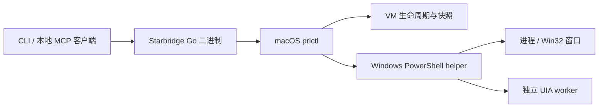

# 架构

[返回项目首页](../README.md) · [安装与使用](USAGE.md) · [验收指南](ACCEPTANCE.md)

Starbridge 当前实现 Parallels Desktop 管理与 Windows 桌面读取。

## 执行与传输

CLI 与 MCP 服务共用 bridge 层的参数校验、回收策略及结果校验。宿主使用参数数组调用 `prlctl`，不通过 shell；Windows 查询只调用固定 helper，以 Base64 JSON 传递动作与参数，不接受任意 guest 命令。

MCP 使用官方 [Go SDK](https://github.com/modelcontextprotocol/go-sdk) 的 stdio 传输，不监听网络端口。默认只开放查询工具；写工具和访问策略须显式启用。详见 [VM 与动作授权](MCP_ACCESS.md)及[并发与取消](MCP_CONCURRENCY.md)。

Windows helper 读取进程、顶层窗口和 UI Automation Control View。UIA 在独立 worker 中执行，由父进程控制超时；查询按节点、深度与文本预算限制输出。请求、字段与预算见 [helper 协议](../guest/windows/README.md)。

## 桌面能力边界

- UIA 依赖应用暴露的可访问性信息；游戏、自绘控件等可能没有完整控件树。接口只读，未实现点击、输入或截图。
- HWND、PID、node_id / RuntimeId 可能失效或被复用，调用方应使用新查询的标识。
- UIA 矩形使用 Windows guest 屏幕物理像素，可能为负数；窗口坐标以 `coordinate_space` 为准，DPI 上下文设置失败时可能依赖当前缩放。坐标不能直接用于 macOS 点击。
- `is_offscreen=false` 和有效矩形不代表控件可操作；遮挡、锁屏、UAC 安全桌面及权限差异均可能影响访问。
- helper 拒绝 Session 0 / 非交互 UI 查询；`prlctl exec --current-user` 仍需在目标登录会话中完成[桌面验收](DESKTOP_TESTING.md)。
- 宿主超时或取消不保证 guest 工作已经停止。副作用命令不自动重试，应先查询实际状态。
- 窗口标题与控件文本属于不可信应用内容，客户端应作为数据处理。

## 相关接口文档

- [Parallels CLI](https://docs.parallels.com/landing/parallels-desktop-developers-guide/command-line-interface-utility)
- [Windows UI Automation](https://learn.microsoft.com/en-us/windows/win32/winauto/uiauto-controlpatternsoverview)
- [UIA 坐标与屏幕缩放](https://learn.microsoft.com/en-us/windows/win32/winauto/uiauto-screenscaling)
- [Windows 交互服务与 Session 0](https://learn.microsoft.com/en-us/windows/win32/services/interactive-services)
