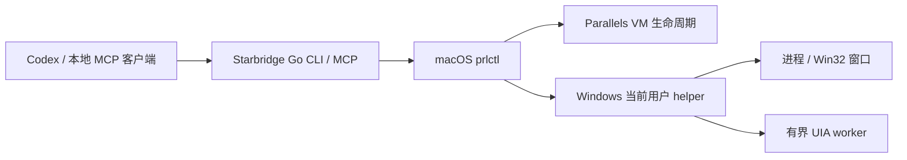

# 架构与路线

[返回项目首页](../README.md) · [安装与使用](USAGE.md) · [验证记录与验收](ACCEPTANCE.md)

Starbridge 的目标是连接 AI 与虚拟运行环境，分别处理环境生命周期及环境内部交互。当前实现仅覆盖 Parallels Desktop 与 Windows 桌面读取；本页同时列出已实现机制和后续扩展方向。

## 当前实现

宿主 CLI 与 MCP 服务由 Go 实现，共用同一个二进制。MCP 使用官方 [Go SDK](https://github.com/modelcontextprotocol/go-sdk) 的 stdio 传输。宿主命令使用参数数组，不通过 shell。Windows 查询调用固定脚本，以 Base64 JSON 传递动作与参数，不接受任意代码或任意 guest 命令。当前版本不监听网络端口。

Windows helper 读取进程、顶层窗口及 UI Automation 的 Control View。UIA 调用在独立 worker 中执行，父进程控制超时，减少挂死 provider 阻塞整个查询的风险。协议与字段见 [Windows helper](../guest/windows/README.md)。真实 Windows 行为仍需按[验收步骤](ACCEPTANCE.md)验证。

## 多后端扩展原则

以下为设计方向，尚未形成通用后端注册接口或统一环境命令。

- **环境管理**：通过后端适配器提供发现、状态查询、创建、启动、停止与回收入口。后端声明实际支持的操作与条件。
- **环境内交互**：按能力提供命令执行、文件操作、进程查询，以及图形环境中的窗口、控件和截图。Windows UI Automation 是第一期的桌面实现，其他操作系统需要独立实现。
- **能力声明**：公共环境模型应标明后端、环境类型、资源 ID、状态及可用能力。不支持的操作应返回明确原因，客户端据此选择下一步。
- **分开管理、传输与交互实现**：虚拟化平台负责管理环境，传输负责进入环境，操作系统交互负责读取或操作其中的软件。后续扩展按这些边界组织，避免把 Windows 桌面细节绑定到所有后端。

容器可以仅提供命令与进程能力。桌面能力取决于操作系统、图形会话和可用的交互实现；接入某个虚拟化后端，不表示其中所有系统都支持读取窗口和按钮。

## 回收语义

用户选择策略，后端落实具体行为。当前 Parallels 实现提供关机保留、恢复指定快照、删除 VM 三种策略。

未来容器后端可按能力提供停止保留、依据镜像与配置重建、删除容器等策略，并明确持久卷与挂载目录的保留规则。VM 挂起与容器暂停、快照恢复与容器重建不能被当作完全相同的操作；它们也不意味着外部数据会一同回滚。

回收策略的 CLI 用法见[安装与使用](USAGE.md#用户配置回收行为)。

## 桌面能力边界

- UIA 依赖应用暴露的可访问性信息。游戏、Canvas、自绘控件和部分 Electron 页面可能没有完整按钮树，不能承诺所有软件均可定位。
- 当前桌面接口只读。HWND、PID、node_id / RuntimeId 均有生命周期；后续实现动作前，需要重新校验目标。
- UIA 坐标属于 **Windows guest 屏幕物理像素**，可能为负数。窗口枚举尝试建立 DPI 上下文，失败时通过 `coordinate_space` 标明坐标依赖当前 DPI。坐标不能直接用于 macOS 点击，窗口边框也可能包含不可见边距。
- `is_offscreen=false` 或一个矩形不等于按钮可点击。遮挡、锁屏、UAC 安全桌面与不同权限等级都可能影响访问。
- `--current-user` 尝试使用登录用户上下文；helper 拒绝 Session 0 / 非交互 UI 查询，但这不足以保证目标桌面可访问。后续可改为常驻登录用户 agent 与经过认证的本地 IPC。
- 杀掉宿主等待进程不等于取消 guest 工作。超时后先观察状态，再决定是否重试；副作用命令不自动重试。
- 窗口标题与控件文本属于不可信应用内容，客户端应把它们作为数据处理。

## 阶段路线

1. **完成 Parallels Desktop 验收**：在真实 VM 验证生命周期和用户配置的回收策略，联调 Windows 进程、窗口、控件、用户会话与 DPI。
2. **扩展 Windows 交互**：在目标校验与会话诊断基础上逐步增加桌面动作、应用管理与截图；视觉识别作为结构化信息缺失时的补充。
3. **提取公共环境接口**：整理独立的 Parallels 适配器，定义公共环境模型、能力声明与错误契约。
4. **接入其他 VM 与容器**：按后端能力实现生命周期、传输和交互，各后端独立完成集成验收。

任务化环境池、租约与自动准备环境留待后续阶段。当前没有实现容器管理、跨后端统一命令或通用后端注册接口。

## 官方依据

- [Parallels CLI 及授权范围](https://docs.parallels.com/landing/parallels-desktop-developers-guide/command-line-interface-utility)
- [虚拟机电源操作](https://docs.parallels.com/landing/parallels-desktop-developers-guide/command-line-interface-utility/manage-virtual-machines-from-cli/general-virtual-machine-management/power-operations)
- [Guest 命令执行](https://docs.parallels.com/landing/parallels-desktop-developers-guide/command-line-interface-utility/manage-virtual-machines-from-cli/general-virtual-machine-management/execute-a-command-in-a-virtual-machine)
- [恢复快照](https://docs.parallels.com/landing/parallels-desktop-developers-guide/command-line-interface-utility/manage-virtual-machines-from-cli/snapshot-management/reverting-to-a-snapshot)
- [Windows UI Automation](https://learn.microsoft.com/en-us/windows/win32/winauto/uiauto-controlpatternsoverview)
- [UIA 屏幕缩放](https://learn.microsoft.com/en-us/windows/win32/winauto/uiauto-screenscaling)
- [Windows 交互服务与 Session 0](https://learn.microsoft.com/en-us/windows/win32/services/interactive-services)
- [Codex MCP 配置](https://developers.openai.com/codex/mcp/)
- [官方 MCP Go SDK](https://github.com/modelcontextprotocol/go-sdk)
- [微软 winapp ui](https://learn.microsoft.com/en-us/windows/apps/dev-tools/winapp-cli/ui-automation)
