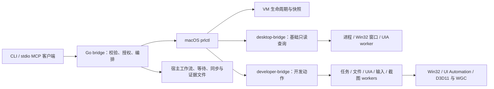

# 架构与能力边界

[返回项目首页](../README.md) · [安装与使用](USAGE.md) · [开发动作](DEVELOPER.md) · [验证与验收](ACCEPTANCE.md)

Starbridge 的宿主进程负责参数与结果校验、授权和编排；Windows helper 执行有限、已注册的 guest 动作。CLI 和 MCP 共用同一 bridge 实现。

## 三类入口

`vm` 直接调用 Parallels CLI，负责电源、克隆、快照和回收策略。命令成功只证明 CLI 完成，后续还要检查 VM 与应用状态。

`guest` 调用 `desktop-bridge.ps1`，只提供进程、顶层窗口和 UIA 控件树读取。它不加载 developer 模块，也不因安装开发模块而获得写能力。

`dev` 使用独立的 `dev-1` 协议。guest 动作由 `developer-bridge.ps1` 加载相邻模块，模块再启动固定 worker；宿主复合动作由 bridge 协调文件、任务、等待、工作流和证据。安装时需要配套入口和完整 `developer/` 树，包括 `.cs` 文件。

宿主向 `prlctl` 传递参数数组，不经过 shell。guest 请求为有界 Base64 JSON，只接受注册动作与校验后的参数，不能从请求指定任意脚本。任务只能运行 guest 本地 profile 配置的程序；修改 helper 或 profile 都是在修改可信执行配置。

## 一次桌面操作怎样完成

先查询进程与窗口，取得当前 HWND、PID 和进程启动时间。控件查询与写动作会重新核对身份；UIA 语义操作会重新搜索目标，要求结果唯一且搜索完整，随后检查对应 pattern 是否可用。

输入要求目标窗口在同一可访问输入桌面和会话中，键盘和鼠标动作还需满足前台、空闲输入状态与命中检查。Windows 会话级 mutex 串行协调 Starbridge 的 UI 写操作，包括不同 CLI 进程；它不会阻止用户或其他工具改变桌面。一次派发成功不能证明应用已经处理完毕。

`input.text` 发送原样 Unicode 字符；UIA `set_value` 写入控件值，`input.key` 派发命名按键。三者语义不同，换行、Tab、输入焦点和应用响应需要按[窗口操作](DEVELOPER_UI_ACTIONS.md)选择和验证。

`ui.observe` 把有界截图和可选 UIA 查询组成观察；UIA 不可用时仍可保留截图。客户端识别候选后，`ui.click` 验证带身份、会话、DPI、边界与时效的观察，再派发一次点击并重新观察。返回的业务验证状态仍为 `pending`，需由调用方检查后置条件。观察 token 由 Windows 当前用户的 DPAPI 保护，不是持久控件标识。详见[视觉流程](DEVELOPER_VISUAL.md)。

## 截图与坐标

截图默认使用 PrintWindow，也可显式选择 Windows Graphics Capture。能力探测只报告支持情况及会话信息，不证明某个窗口一定能捕获有效画面；失败不会自动改用桌面截图或切换后端。

PrintWindow 使用 Win32 窗口边界；WGC 使用捕获 item 建立帧池，并将有效内容与已测得的窗口范围对应，必要时裁剪可确认的边距。无法确定物理原点时返回错误。宿主校验完整 PNG、尺寸、哈希、请求预算及捕获方法，MCP 返回原生图片内容。见[截图契约](DEVELOPER_SCREENSHOTS.md)。

UIA、截图与输入使用 Windows guest 屏幕物理像素，允许负坐标；基础窗口枚举在 DPI 上下文建立失败时会明确报告坐标限制。它们不等于 macOS 或 Parallels 查看器坐标。视觉候选可来自完整图片的缩放版本，不能直接使用裁剪或拼接后的图片坐标。

## MCP 授权与并发

服务使用官方 [Go SDK](https://github.com/modelcontextprotocol/go-sdk) 的 stdio 传输，不监听网络端口。默认只有基础只读工具；VM 电源写工具、开发工具、guest 写动作分别需要显式启用。宿主文件动作还需要已有的显式 workspace，受文件路径和嵌套调用授权检查约束。

访问策略按 VM UUID 与工具名授权；工作流、视觉动作及证据中的下层动作也要获得相应权限。同一服务限制后端调用总量，按 VM 协调生命周期与开发写操作，宿主文件动作另有串行保护。这些约束有各自范围，不构成跨服务、跨应用的全局事务。见[MCP 开发工具](MCP_DEVELOPER.md)、[访问策略](MCP_ACCESS.md)和[并发与取消](MCP_CONCURRENCY.md)。

## 结果与限制

- UIA 数据与语义操作取决于应用提供的可访问性实现。游戏、自绘窗口或远程画布可能只暴露外层窗口；缺少控件时可用截图辅助客户端定位，但项目不内置 OCR 或视觉识别。
- HWND、PID、UIA RuntimeId、窗口几何和前台状态都可能变化。新查询、身份校验和观察时效降低误操作风险，不能使整张桌面原子化。
- 截图和 UIA 是不同时间的采样；可见性、有效矩形、非黑色图片或已派发输入都不足以证明业务成功。使用明确的等待或断言核对结果。
- Session 0、锁屏、安全桌面、UIPI、完整性级别和前台限制可能阻止操作；helper 不绕过这些系统边界。`--current-user` 仍需在目标登录环境中完成验收。
- 超时、取消、部分输入或响应损坏可能发生在副作用之后。`outcome:unknown` 要求先观察状态；写动作不自动重试，工作流清理也不等于回滚。
- 文本、截图、窗口标题、任务输出和证据可能包含应用显示的数据。文本输入的脱敏不会隐藏后续截图或查询中可见的内容；公开测试资料使用合成数据。

## 实现与系统接口

实现入口位于源码目录的 `internal/cli`、`internal/bridge`、`internal/mcpserver` 和 `guest/windows`。完整调用边界见[开发协议](DEVELOPER.md)与[基础 helper 协议](../guest/windows/README.md)。

- [Parallels CLI](https://docs.parallels.com/landing/parallels-desktop-developers-guide/command-line-interface-utility)
- [Windows UI Automation patterns](https://learn.microsoft.com/en-us/windows/win32/winauto/uiauto-controlpatternsoverview)
- [UIA 坐标与缩放](https://learn.microsoft.com/en-us/windows/win32/winauto/uiauto-screenscaling)
- [Windows Graphics Capture](https://learn.microsoft.com/en-us/windows/uwp/audio-video-camera/screen-capture)
- [SendInput](https://learn.microsoft.com/en-us/windows/win32/api/winuser/nf-winuser-sendinput)
